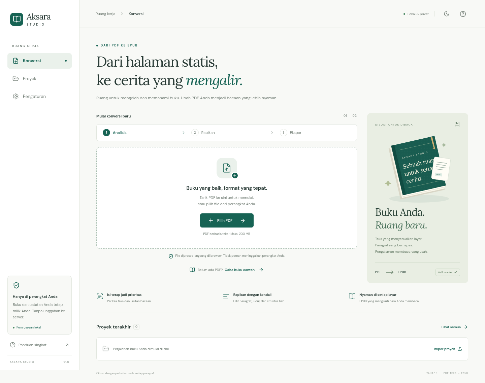
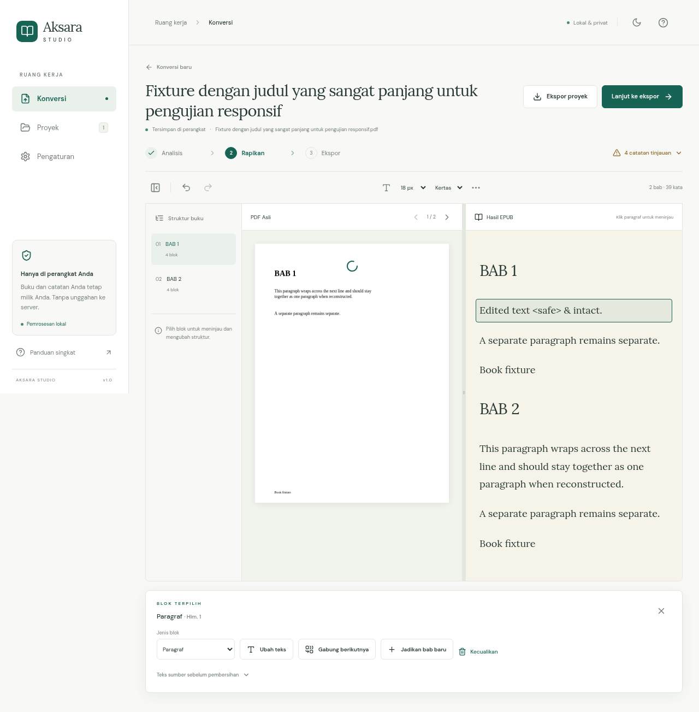

<div align="center">

# Aksara Studio

### Ruang untuk mengolah dan memahami buku.

Ubah PDF berbasis teks menjadi **EPUB 3 reflowable** yang nyaman dibaca.<br />
Proses, tinjau, dan rapikan buku langsung di browser Anda.

[](https://github.com/andikapramudyadika/aksara-studio/actions/workflows/pages.yml)


[**Buka aplikasi →**](https://andikapramudyadika.github.io/aksara-studio/) · [Panduan penggunaan](#cara-menggunakan) · [Pengembangan](#pengembangan-lokal) · [Batas dukungan](#batas-dukungan)

</div>



## Tentang proyek

Aksara Studio membantu memindahkan buku dari halaman PDF yang statis ke format EPUB yang mengikuti ukuran layar dan preferensi pembaca. Fokus tahap pertama adalah menjaga teks dan sumbernya tetap dapat ditinjau, merekonstruksi paragraf, serta menyediakan kendali manual sebelum ekspor.

Aplikasi ini berjalan sebagai situs statis. Tidak diperlukan backend konversi, akun aplikasi, API key, atau layanan berbayar. **Dukungan utama adalah PDF teks satu kolom**, dengan laporan untuk bagian yang perlu diperiksa.

## Fitur

| Area            | Kemampuan tahap pertama                                                                             |
| --------------- | --------------------------------------------------------------------------------------------------- |
| Impor PDF       | Pilih file atau drag-and-drop, hingga 200 MB; ekstraksi teks, koordinat, font, dan outline PDF      |
| Rekonstruksi    | Pengelompokan baris dan paragraf; heading, dialog/kutipan, daftar, dan pemisah adegan               |
| Tinjauan sumber | PDF asli dan hasil berdampingan di desktop; tab terpisah di mobile; klik blok menuju halaman sumber |
| Editor          | Ubah teks dan jenis blok, tingkat heading, pisah/gabung paragraf, buat bab, undo/redo selama sesi   |
| Laporan         | Kandidat header/footer, halaman tanpa teks, operasi gambar, dan layout yang perlu ditinjau          |
| Proyek lokal    | Autosave IndexedDB, checkpoint per halaman, batal/lanjutkan analisis, ekspor/impor arsip `.aksara`  |
| Ekspor EPUB     | EPUB 3 reflowable, metadata, sampul otomatis atau PNG/JPEG, XHTML, CSS, dan navigasi bab/heading    |
| Kenyamanan      | Light/dark mode, ukuran huruf, jarak baris, lebar dan tema baca, serta pembaca EPUB bawaan          |

> **Pelestarian isi tidak dijamin otomatis.** Gambar isi, tabel, rumus, footnote, dan halaman pindaian belum direkonstruksi secara andal. Selalu bandingkan hasil dengan PDF sumber sebelum membagikan EPUB.

## Cara menggunakan

1. **Pilih PDF** yang teksnya dapat dipilih. Gunakan **Coba buku contoh** jika ingin mencoba alurnya terlebih dahulu.
2. **Tunggu analisis.** Tetap buka tab; checkpoint disimpan setiap halaman. Analisis dapat dibatalkan dan dilanjutkan.
3. **Tinjau paragraf.** Bandingkan hasil dengan PDF asli. Klik blok untuk membuka halaman sumber dan kontrol edit.
4. **Rapikan struktur.** Koreksi teks, pisah di posisi kursor, gabung paragraf, tentukan tingkat heading, atau mulai bab baru. Kandidat header/footer tetap disertakan sampai Anda memilih **Kecualikan**; blok dapat dipulihkan.
5. **Lengkapi metadata** judul, penulis, bahasa, identifier, dan sampul, lalu pilih **Buat EPUB → Unduh EPUB**.
6. **Cadangkan proyek.** Ekspor `.aksara` untuk membawa PDF asli, struktur buku, dan koreksi ke browser/perangkat lain.



## Privasi dan penyimpanan

- PDF, teks, dan koreksi diproses di perangkat Anda. Isi buku tidak dikirim ke server konversi atau layanan AI.
- Dependensi runtime, worker, font, CMaps, dan aset PDF.js disajikan bersama aplikasi.
- Proyek berada di **IndexedDB browser dan origin yang sedang digunakan**. Data proyek pada domain lain tidak otomatis muncul di GitHub Pages; pindahkan melalui ekspor/impor `.aksara`.
- Menutup tab dapat menghentikan analisis. Checkpoint bukan proses latar belakang permanen.
- Menghapus data situs atau tekanan kuota browser dapat menghapus proyek. Simpan cadangan proyek lokal secara berkala.
- Repository hanya berisi source dan fixture sintetis. PDF pengguna, hasil EPUB, dan arsip proyek tidak di-commit.

## Pengembangan lokal

**Prasyarat:** Node.js 24 dan npm.

```bash
git clone https://github.com/andikapramudyadika/aksara-studio.git
cd aksara-studio
npm ci
npm run dev
```

Buka alamat lokal yang dicetak Vite. Untuk memeriksa versi produksi:

```bash
npm run build
npm run preview
```

`predev` dan `prebuild` menyalin CMaps, standard fonts, dan WASM dari paket PDF.js ke aset publik. Tidak perlu mengunduh aset tersebut dari CDN saat konversi berjalan.

### Perintah pengembangan

| Perintah               | Fungsi                                                       |
| ---------------------- | ------------------------------------------------------------ |
| `npm run dev`          | Menjalankan server pengembangan                              |
| `npm run typecheck`    | Memeriksa tipe TypeScript                                    |
| `npm test`             | Menjalankan 18 tes rekonstruksi, editor, dan struktur EPUB   |
| `npm run build`        | Menghasilkan situs statis di `dist/`                         |
| `npm run preview`      | Menyajikan production build secara lokal                     |
| `npm run test:e2e`     | Menguji alur nyata melalui Chromium/Playwright               |
| `npm run fixture:epub` | Membuat EPUB sintetis di `.tmp/fixture.epub` untuk EPUBCheck |
| `npm run format`       | Memformat source dan dokumentasi dengan Prettier             |

### Pengujian browser

```bash
npx playwright install chromium
npm run build
npm run test:e2e
```

Pada Linux, bila dependensi sistem browser belum tersedia, gunakan `npx playwright install --with-deps chromium`. Konfigurasi memakai `/usr/bin/chromium` jika tersedia; Anda juga dapat menentukan executable melalui `CHROMIUM_PATH`. Screenshot dan artefak uji tersimpan di `test-results/artifacts/`, atau lokasi yang ditentukan oleh `AKSARA_ARTIFACT_DIR`.

## Arsitektur

```text
src/
├── components/              # Pratinjau PDF dan pembaca EPUB (lazy-loaded)
├── core/
│   ├── model.ts             # Book → chapters → blocks, source refs, audit
│   ├── pdf.ts               # Ekstraksi PDF.js dan koordinat viewport
│   ├── layout.ts            # Urutan area/kolom dan rekonstruksi struktur
│   ├── layout.worker.ts     # Analisis layout di Web Worker
│   ├── editor.ts            # Operasi edit yang dapat di-undo
│   ├── storage.ts           # IndexedDB dan penyimpanan proyek
│   ├── project.ts           # Impor/ekspor arsip proyek lokal
│   ├── epub.ts              # Pengemasan EPUB 3
│   ├── export.worker.ts     # ZIP EPUB di Web Worker
│   └── validation.ts        # Pemeriksaan XML, mimetype, tautan dan aset
├── App.tsx                  # Alur kerja, navigasi dan state antarmuka
└── style.css                # Token visual, tema dan layout responsif
```

Setiap blok memiliki ID stabil, jenis, teks hasil, `originalText`, urutan, dan referensi halaman/posisi sumber. Mengedit hasil tidak mengganti teks sumber. Penghapusan kandidat dilakukan sebagai pengecualian yang dapat dipulihkan dan dicatat dalam audit.

Stack: **React · TypeScript · Vite · PDF.js · Web Workers · IndexedDB · fflate · EPUB.js · Lucide**. Rincian keputusan dan lisensi dependensi tersedia di [DEPENDENCIES.md](docs/DEPENDENCIES.md).

## Validasi dan kualitas

- **18 tes inti** mencakup paragraf terpisah/terbungkus/lintas halaman, dialog, daftar, heading, scene break, header/footer, dua kolom, halaman kosong, karakter khusus, pemenggalan konservatif, editor, serta referensi EPUB.
- **5 skenario browser** mencakup unggah hingga unduh EPUB, pembaca EPUB.js, autosave/reload, arsip proyek, checkpoint, keyboard, reduced motion, serta kegagalan penyimpanan dan PDF rusak.
- Pemeriksaan visual dilakukan pada desktop, tablet, dan viewport mobile 320/375 px, termasuk tema gelap.
- **EPUBCheck 5.4.0** memvalidasi fixture sintetis dalam CI. Pemeriksaan ringan di browser adalah lapisan terpisah, bukan pengganti EPUBCheck.
- Workflow Pages memeriksa deployment publik dengan HTTP dan menjalankan smoke test alur konversi melalui browser.

Catatan pemeriksaan dan hal yang belum diuji tersedia di [VERIFICATION.md](docs/VERIFICATION.md). Emulasi viewport belum menggantikan pengujian perangkat Chrome Android fisik atau audit WCAG menyeluruh.

## Deployment GitHub Pages

Aplikasi dipublikasikan dari branch `main` melalui [workflow Pages](.github/workflows/pages.yml).

1. Di repository, buka **Settings → Pages → Build and deployment**.
2. Pilih **Source: GitHub Actions**.
3. Push ke `main`, atau jalankan **Actions → Test, build, and deploy Pages → Run workflow**.
4. Tunggu job **build**, **deploy**, dan **verify** selesai. URL produksi tersedia pada environment `github-pages`.

Workflow menjalankan typecheck, tes inti, EPUBCheck, dan build sebelum deploy. Base path diambil dari konfigurasi Pages agar aset, worker, dan font bekerja di subpath repository. Navigasi memakai hash routing agar refresh tetap aman pada hosting statis.

```bash
# Contoh build manual untuk project Pages
BASE_PATH=/aksara-studio/ npm run build
```

Tidak ada API key atau secret konversi yang perlu disetel. Izin `pages: write` dan `id-token: write` hanya dipakai workflow untuk deployment.

## Batas dukungan

| Kasus                                        | Perilaku saat ini                                                                                 |
| -------------------------------------------- | ------------------------------------------------------------------------------------------------- |
| PDF teks satu kolom                          | Target utama; tetap perlu tinjauan hasil                                                          |
| PDF dua kolom                                | Urutan per kolom bila terdeteksi; ditandai untuk pemeriksaan                                      |
| PDF pindaian / halaman tanpa teks            | Dilaporkan; OCR harus dilakukan di aplikasi lain                                                  |
| Gambar isi, tabel, rumus, footnote           | Belum dipertahankan secara andal; bukan konversi isi lengkap                                      |
| Header/footer dan nomor halaman              | Kandidat berdasarkan posisi/pengulangan; tidak dihapus otomatis                                   |
| Pemenggalan kata                             | Soft hyphen dapat digabung; tanda hubung terlihat dipertahankan secara konservatif                |
| Bookmark PDF                                 | Membantu label bab bila dapat dipetakan; tidak menjamin seluruh hierarki                          |
| Buku sangat panjang                          | Hasil teks belum divirtualisasi; memori dan performa bergantung perangkat                         |
| Teks vertikal, RTL, CJK atau layout campuran | Memerlukan pemeriksaan khusus; belum diuji menyeluruh                                             |
| Undo/redo                                    | 30 snapshot selama sesi; koreksi terakhir tersimpan, riwayat sesi tidak dipulihkan setelah reload |

## Roadmap

- Ekstraksi serta penempatan gambar dengan validasi referensi sumber.
- Perbaikan layout campuran, tabel, dan catatan kaki.
- Virtualisasi pratinjau teks untuk buku panjang.
- Terjemahan dan ringkasan melalui OpenRouter setelah pengujian origin/CORS dan pengelolaan key sesi.
- Eksplorasi PDF terjemahan dengan relayout teks yang benar, tanpa menjanjikan tampilan identik.

Fitur AI **belum tersedia**. Rancangan integrasi, privasi, checkpoint, penanganan error, dan biaya terdokumentasi di [OPENROUTER.md](docs/OPENROUTER.md).

## Kontribusi

Temukan masalah? Buka [issue](https://github.com/andikapramudyadika/aksara-studio/issues) dengan langkah reproduksi, browser, dan jenis layout PDF. Gunakan fixture sintetis atau dokumen yang aman dibagikan. Sebelum mengajukan perubahan, jalankan `npm run typecheck`, `npm test`, dan `npm run build`; sertakan pengujian browser jika alur UI berubah.
